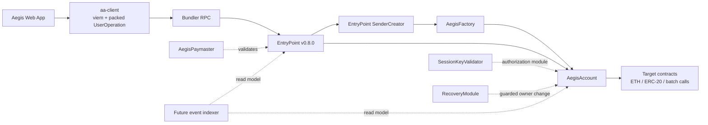

# Aegis Wallet Architecture

## Scope of this milestone

This document records the implemented contract boundary: a single-owner smart
account, a deterministic factory, a policy-constrained paymaster, session-key
authorization, guardian recovery, and a local ERC-4337 UserOperation lifecycle.
The web UI and client package deliberately keep deployment and submission state
explicit instead of pretending that a missing bundler is successful.

## Component diagram

## Contract responsibilities

### `AegisAccount`

- Stores an immutable configured EntryPoint and a non-zero owner.
- Implements `BaseAccount.validateUserOp` and returns ERC-4337 signature failure
  as validation data instead of reverting for a bad owner signature.
- Uses OpenZeppelin `SignatureChecker`, allowing the owner to be an EOA or an
  ERC-1271-compatible contract signer.
- Exposes `execute` and `executeBatch`, but both paths require the configured
  EntryPoint. A batch reverts as a whole if any call fails.
- Has no public initializer. The constructor is the only owner assignment path.
- Allows an owner change only through an account self-call. A direct EOA call is
  rejected; the self-call must be wrapped in an EntryPoint-validated UserOperation.

### `AegisFactory`

- Computes the CREATE2 address from the account creation bytecode, EntryPoint, and owner.
- Restricts account creation to the EntryPoint v0.8 `SenderCreator` contract.
- Returns the already-deployed account for a repeated owner/salt pair.
- Is used as the factory prefix in the v0.8 `initCode` field for counterfactual deployment.

### `SessionKeyValidator`

- Session keys are configured only through an account self-call.
- A session signature is encoded as `(sessionKey, signature)` and validated against
  the same ERC-4337 UserOperation hash as an owner signature.
- A session operation must be an `execute` or `executeBatch` call. Every nested
  target, selector, per-call value, and cumulative value is checked before the
  operation is accepted.
- Spending is reserved during validation. This intentionally consumes the reserved
  value even if the downstream call later reverts, preventing failed execution from
  becoming a limit bypass.

### `RecoveryModule`

- The account owner configures a unique guardian set, threshold, and minimum delay
  through a self-call.
- A registered guardian can propose and approve a recovery. Each guardian can approve
  only once per proposal.
- Any guardian or the current owner can cancel a proposal; finalization is permissionless
  only after threshold and delay requirements pass.
- Finalization changes the account owner and emits a recovery event.

### `AegisPaymaster`

- The first paymaster mode sponsors only single-call `AegisAccount.execute` operations.
- Account, target, and function selector allowlists are enforced on-chain.
- A sponsor signer authorizes a policy over sender, nonce, init-code hash, call-data
  hash, target, selector, cost ceiling, and validity window. The signature excludes
  `paymasterAndData` itself to avoid circular signing.
- Maximum-cost reservations are taken during validation and settled in `postOp`; this
  prevents a bundle from oversubscribing the aggregate budget.
- Only the admin can configure policy, stake, or withdrawals; only EntryPoint can
  invoke validation and post-operation accounting.

## UserOperation lifecycle

1. The client derives `AegisFactory.getAddress(owner, salt)` locally.
2. The client builds `initCode = factory || createAccount(owner, salt)` when the
   account has no bytecode.
3. The client builds `callData` for `AegisAccount.execute` or `executeBatch`.
4. EntryPoint computes the v0.8 UserOperation hash and the owner signs that hash.
5. The bundler simulates validation and submits the operation to EntryPoint.
6. EntryPoint asks `SenderCreator` to execute the factory init code if needed.
7. The account validates the owner or restricted session-key signature and pays its
   required prefund, unless the policy paymaster is used.
8. EntryPoint calls the account, which executes the requested call or atomic batch.
9. The frontend waits for a UserOperation receipt and underlying transaction receipt
   before presenting success.

## Compatibility decision

This milestone pins the Solidity package to `eth-infinitism/account-abstraction`
`v0.8.0` and uses Solidity `0.8.28`, matching the v0.8 reference contracts. The
TypeScript package pins `permissionless` `0.5.2` and `viem` `2.44.4`, and its
integration boundary uses `getUserOperationTypedData` plus an explicit EntryPoint
v0.8 configuration. This avoids silently selecting a different SDK default and
keeps the packed UserOperation fields, EIP-712 signing, and factory ABI aligned.

EntryPoint v0.9 is not selected for this first slice even though the official
release notes describe it as ABI-compatible with v0.8: the repository will first
prove the v0.8 account and client path, then evaluate a version upgrade as a
separate compatibility change.

## Deferred boundaries

- The paymaster validates policies on-chain; frontend sponsorship UI will never
  be treated as authorization.
- Session keys and guardian recovery are separate modules with explicit calldata
  and batch restrictions.
- The indexer will never be authoritative for balances, ownership, or validity.
- No arbitrary `delegatecall` entry point is exposed by the core account.
